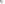
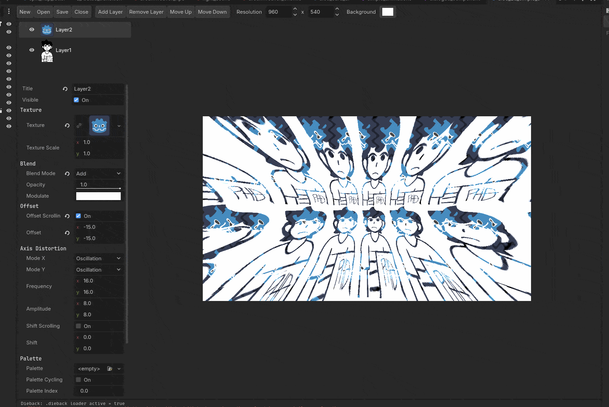

<h1 align="center">
  
  VenuDie
</h1>

*Dieback, ported to Godot.*
*Dieback is back.*



**Prominently used in [Colorblind](https://nicenibbles.com/colorblind-old)**

VenuDie is a Godot 4 addon for making animated, distorted battle backgrounds, the wavy, scrolling, palette-cycling kind you see in classic RPG battle scenes. You build backgrounds in a dedicated **Dieback** tab at the top of the editor, save them as `.dieback` files, and drop them into your game with a single node.

It is a port of [Dieback](https://github.com/Okanoa/Dieback) by Okanoa. This is **not** the original Dieback. See [Credits](#credits) and [License](#license).

## Features

- **Main-screen editor tab** with a layer list, live preview, and a full property inspector
- **Stackable layers**, with the top layer drawn last, plus per-layer visibility toggles
- **Blend modes:** Alpha, Add, Subtract
- **Axis distortion**, set independently for X and Y: Oscillation, Interlaced, Compression, Linear Scaling
- **Scrolling** for texture offset and for the distortion wave itself
- **Palette swapping and cycling** driven by a palette texture
- **Plane distortion:** fisheye and anti-fisheye
- **Opacity and modulate tint** per layer
- **Custom resolution and background color** per background
- **Loop mode** so animations repeat cleanly every N seconds
- **Nodes for 2D, 3D and UI**, so you can use a background in any kind of scene

## Installation

1. Copy the `addons/dieback` folder into your project's `addons/` folder.
2. Open **Project > Project Settings > Plugins** and enable **Dieback**.
3. A **Dieback** tab appears at the top of the editor, next to 2D, 3D and Script.

Enabling the plugin also registers a `DiebackRuntime` autoload. It lets your exported game load `.dieback` files, so leave it in place.

## Creating a background

1. Open the **Dieback** tab and click **New**.
2. Click **Add Layer** and select it in the list.
3. Assign a **Texture** in the inspector, then adjust blend, offset, distortion, palette, and plane settings.
4. Add more layers and reorder them with **Move Up** and **Move Down**. Index 0 is the top layer.
5. Set the **Resolution** and **Background** color in the toolbar.
6. Click **Save** and save the file as a `.dieback`.

Use **Open** to load an existing `.dieback` (or `.tres`) file.

### Layer settings

| Group | What it does |
|---|---|
| Texture | The image to draw, plus a scale multiplier |
| Blend | Blend mode, opacity, and tint color |
| Offset | Static offset, or scrolling speed in pixels per second |
| Axis Distortion | Mode, frequency, amplitude, and shift for X and Y |
| Palette | Remap the texture through a palette texture, with optional cycling |
| Plane Distortion | Fisheye strength from -1 to 1 |

## Using a background in your game

Pick the node that fits your scene and assign your `.dieback` file to its **Data** property:

| Node | Base type | Use it for |
|---|---|---|
| `BattleBackground` | `Control` | UI scenes and anything laid out with containers |
| `BattleBackground2D` | `Sprite2D` | 2D scenes |
| `BattleBackground3D` | `Sprite3D` | Placing a background in a 3D scene |

All three share these properties:

- **Data:** the `.dieback` resource to display
- **Loop:** wrap animation time so it repeats
- **Loop Duration:** length of the loop in seconds

From code:

```gdscript
var bg := BattleBackground2D.new()
bg.data = load("res://backgrounds/forest.dieback")
bg.loop = true
bg.loop_duration = 4.0
add_child(bg)
```

### Tips

- Layer textures should tile cleanly, because they wrap in both directions.
- Backgrounds render at their own resolution (320x180 by default) with nearest-neighbor filtering. This keeps the pixel look intact at any display size.
- For palette layers, the red channel of the texture picks the column in the palette image, and the palette index picks the row.

## Credits

- **VenuDie** was made by me.
- It is based on [Dieback](https://github.com/Okanoa/Dieback) by Okanoa. The distortion modes and effect math come from the original. This repository is a Godot port and is not the original software.

## License

The Godot port is released under the license in [`LICENSE`](LICENSE).

The original Dieback is copyright (c) 2022 Okano and is licensed under the zlib/libpng license. Its notice is kept unaltered in [`LICENSE-Dieback`](LICENSE-Dieback).
